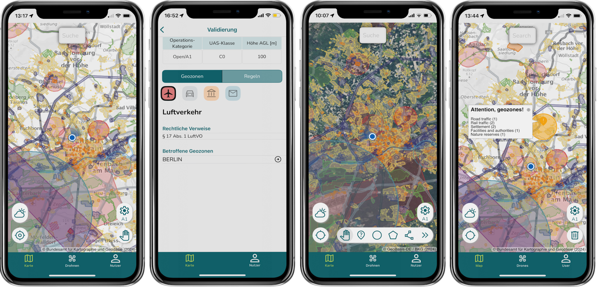
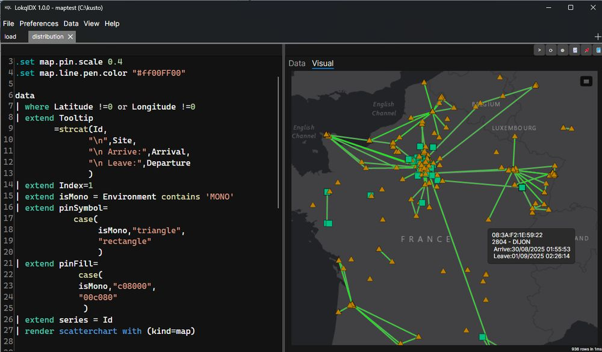
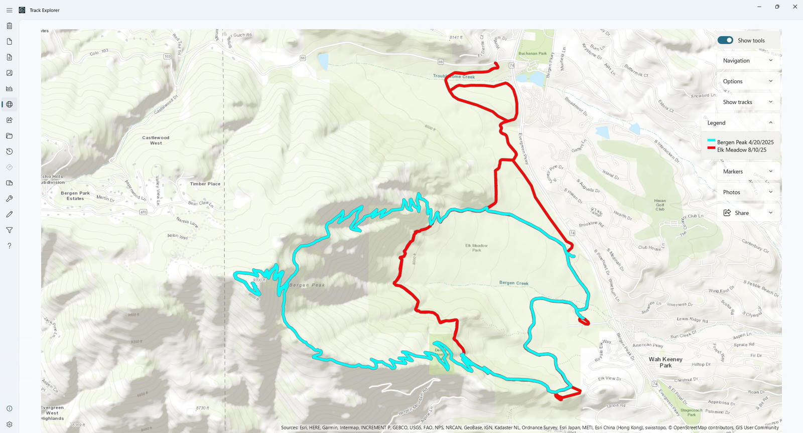
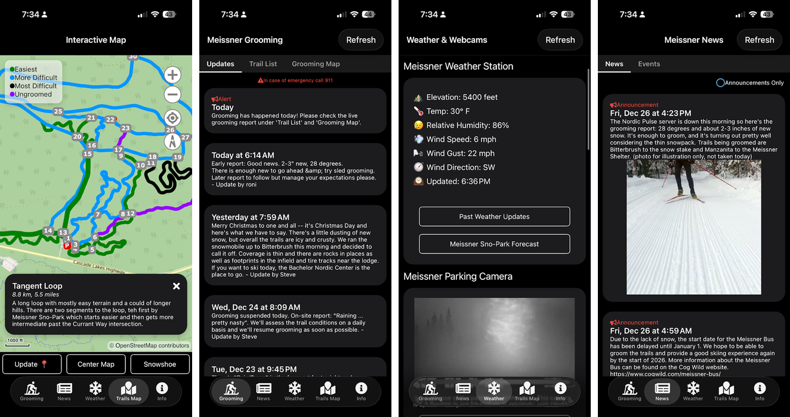
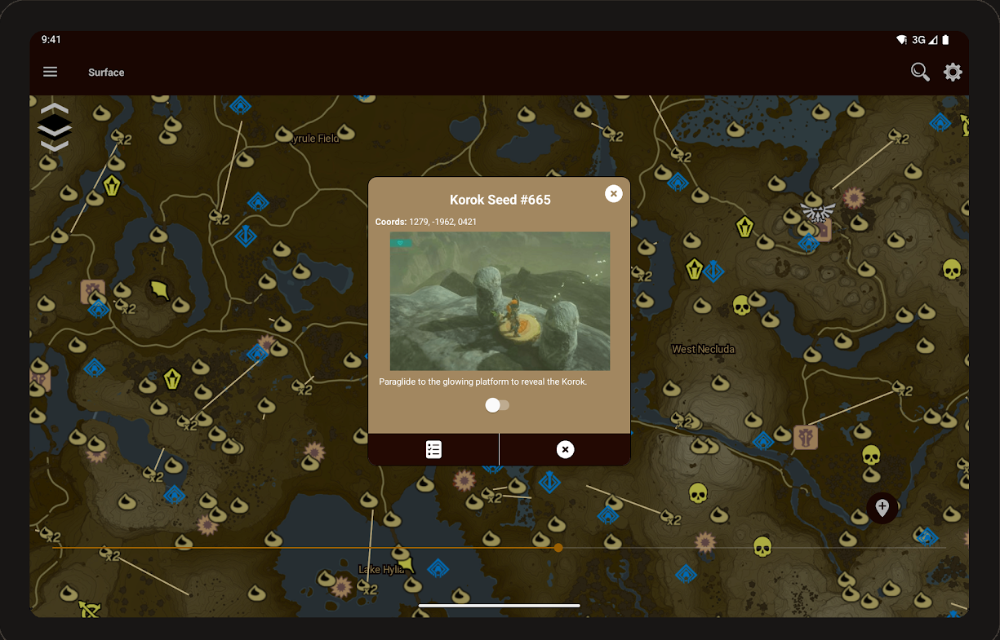
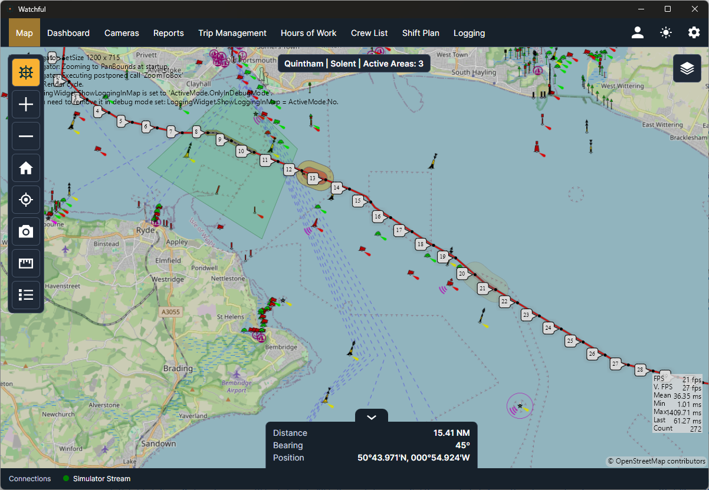

# Projects That Use Mapsui

### Breath Companion

### Droniq Maps

### LokqlDx - KQL data explorer

### Squadra

### Rutas Tarija

### Track Explorer

### Meissner Nordic

### Tears Companion

### Watchful

